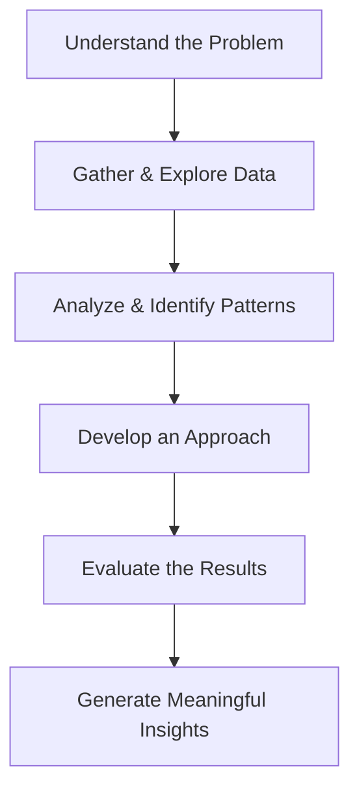

 

 

---

## 👋 About Me

I am a **Mathematics graduate from Universitas Negeri Padang** with a strong interest in **data, technology, and machine learning**. My academic background has shaped the way I approach problems through logical reasoning, analytical thinking, and a structured problem-solving process.

I enjoy exploring data, identifying patterns, and understanding how information can be transformed into meaningful insights. I continuously develop my technical skills through independent learning, practical projects, and exploring new technologies.

I believe that **good analysis starts with the right questions, a clear process, and a deeper understanding of the data.**

- 🎓 **Education:** Bachelor's Degree in Mathematics — Universitas Negeri Padang
- 📊 **Academic Achievement:** GPA 3.31 / 4.00
- 💡 **Interest:** Data Analytics, Data Science, Data Engineering, and Machine Learning
- 🌱 **Currently Learning:** Data Visualization, SQL, Python, and Business Intelligence
- 📍 **Location:** Indonesia
- 🔎 **Career Interest:** Open to opportunities in data and technology.

---

## 🛠️ Skills & Tools

| Category | Skills |
|---|---|
| 📊 **Data Analysis** | Exploratory Data Analysis (EDA), Data Cleaning, Data Interpretation |
| 📈 **Data Visualization** | Tableau, Power BI, Google Looker Studio |
| 📑 **Spreadsheet** | Microsoft Excel |
| 🗄️ **Database** | SQL |
| 🐍 **Programming** | Python, Pandas, NumPy, Scikit-learn |
| 🤖 **Machine Learning** | Regression, Classification, Model Evaluation |
| 🧠 **Mathematics** | Statistical Analysis, Logical Reasoning, Mathematical Modeling |

---

## 🧩 How I Approach Problems

My mathematical background influences how I approach learning and problem-solving. I prefer understanding the fundamentals, breaking complex problems into smaller parts, and evaluating results systematically.

---

## 🧠 Strengths

- **Analytical Thinking** — Approaching problems logically and systematically.
- **Problem Solving** — Breaking down complex problems into manageable steps.
- **Attention to Detail** — Paying attention to data quality and analytical results.
- **Adaptability** — Willing to explore new tools, concepts, and technologies.
- **Continuous Learning** — Developing knowledge through independent study and practical experience.
- **Critical Thinking** — Evaluating information before drawing conclusions.

---

## 📚 Learning Philosophy

I believe learning is a continuous process. I prefer understanding how something works rather than simply knowing how to use it.

With a background in mathematics, I enjoy connecting theoretical concepts with practical applications, particularly in data analysis and technology.

My goal is to keep improving my analytical and technical abilities while building solutions that provide meaningful value.

---

## 📫 Let's Connect

  

*Turning curiosity into knowledge, and knowledge into meaningful insights.*

